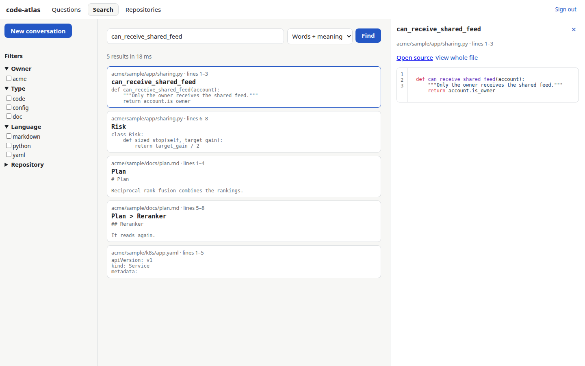
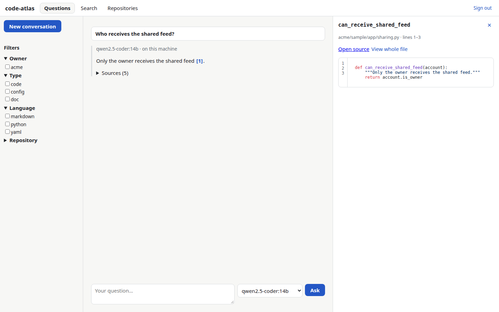

# code-atlas

**Find what you already coded, and ask questions about it — over all your repositories, on your
own machine.**

code-atlas indexes the git repositories you point it at and gives you:

- **Search** that matches both exact words (function names, rare terms) and meaning ("where do I
  check that an account may receive the shared feed?"), then lets a reranker read the best
  candidates. On a real 40-question evaluation over ~110 repositories, the right file was in the
  first 10 results for 98 % of the questions (MRR 0.81).
- **Questions** answered by a local model that cites its sources as `repo/path:lines`; a click on a
  citation opens the code.
- **Two fronts on the same API**: a web app (React) and a Linux desktop app (Flutter), in English
  or French.

Everything runs locally by default: embeddings, reranking, the chat model, the database. Code
leaves your machine only if you enable a remote gateway *and* list, model by model, providers
you have checked retain nothing.

| Search | Questions |
|---|---|
|  |  |

*Screenshots taken by the end-to-end test on its sample repository.*

## How it works

```text
 web/ React (4173) ──┐                          ┌─► ParadeDB (55432): BM25 + pgvector
                     ├─► API FastAPI (8790) ────┼─► Ollama or any OpenAI-compatible server (11434)
 desktop/ Flutter ───┘   token checked on every └─► optional gateway (policy-listed models only)
                         request
```

1. **Corpus** — every git repository under your `roots`; optional owner filter and fork check;
   only files tracked by git; binaries, generated files, key files and duplicates skipped.
   [detect-secrets](https://github.com/Yelp/detect-secrets) masks lines that look like secrets
   before anything is indexed.
2. **Chunking** — code is split along its structure with tree-sitter (one function, method or
   short class per chunk, `Class.method` symbols); Markdown and LaTeX by heading; notebooks by
   cell.
3. **Index** — ParadeDB (PostgreSQL + pg_search BM25 + pgvector HNSW). Incremental: only files
   whose git hash changed are read again.
4. **Search** — words (BM25) + meaning (vectors) + exact symbol, fused by Reciprocal Rank Fusion,
   then a cross-encoder reranks the top 30.
5. **Chat** — the 8 best chunks go to the model, fenced as data (prompt-injection guard); every
   `[n]` citation is checked against the supplied chunks.

## Install

Requirements: Linux, git, podman (with the NVIDIA CDI for a GPU), [uv](https://docs.astral.sh/uv/),
Node.js and npm, Flutter (for the desktop app).

```bash
git clone https://github.com/doctum-consilium/code-atlas-oss.git && cd code-atlas-oss
bash scripts/install.sh --roots "~/code ~/work"
```

The script is re-runnable and only does what is missing: settings, database and Ollama
containers, chat model, Python environment, corpus and index, web build, desktop build, user
services (API, web, nightly index), then checks.

| Option | Effect |
|---|---|
| `--roots "…"` | folders whose subfolders are git repositories (first install) |
| `--no-gpu` | no NVIDIA card: models run on the CPU |
| `--no-index` | do not index now; the 03:30 timer will |
| `--no-models` | do not download the chat model |
| `--no-desktop` | do not build the Flutter app |
| `--check` | only check an existing installation |
| `--uninstall` | remove the services, keep data and settings |

Then open <http://127.0.0.1:4173> and paste the token from `~/.config/code-atlas/api-token`
(the desktop app reads it by itself).

## Configure

One file: `~/.config/code-atlas/config.toml`, created from
[config/config.example.toml](config/config.example.toml). Everything is there:

| Section | What you choose |
|---|---|
| `language` | interface and answers in `en` or `fr` |
| `[corpus]` | `roots`, accepted `owners`, `exclude_forks`, excluded repositories, `local_only` repositories, source link templates per git host (GitHub and GitLab built in) |
| `[auth]` | `token` (one user on this machine) or `oidc` (Keycloak, Authentik, Auth0, Zitadel…: issuer, audience, clients, roles claim, allowed e-mails) |
| `[models]` | any sentence-transformers embedder and dimension, reranker (or none), local OpenAI-compatible server and models |
| `[gateway]` | optional OpenAI-compatible gateway (LiteLLM…) and its policy file |
| `[limits]`, `[thermal]` | rate limits; pause heavy work above a GPU/CPU temperature |

Remote models are allowed by a separate policy file
([config/policy.example.toml](config/policy.example.toml)): one entry per provider with the source
you checked and its date; for AWS Bedrock the account's data-retention mode is read every day and
must be `none`.

**OIDC with Keycloak**: `scripts/keycloak_setup.py` creates the public PKCE clients, the
audience, the roles and an optional password + TOTP login flow:

```bash
KC_ADMIN=… KC_ADMIN_PASSWORD=… python3 scripts/keycloak_setup.py \
  --url https://id.example.com --realm main --email you@example.com
```

## Use from the terminal

```bash
cd backend
uv run atlas corpus                      # select repositories and files (report in ~/.local/share/code-atlas)
uv run atlas index                       # update the index (changed files only)
uv run atlas search "sized stop" --excerpts
uv run atlas eval --questions ../eval/example-questions.yaml   # recall@10 and MRR
```

Write your own evaluation file with real questions about your code: it is the only honest way to
compare embedders, rerankers or chat models on *your* repositories.

## Security

See [SECURITY.md](SECURITY.md). In short: loopback only, a token on every request, secrets masked
before indexing, tokens never stored by the browser, remote models off by default and gated by a
written policy.

## Develop

See [CONTRIBUTING.md](CONTRIBUTING.md). `bash scripts/ci_local.sh` replays the CI: ruff, mypy
strict, backend tests on a real database (coverage ≥ 85 %), bandit, pip-audit, contract drift,
ESLint strict, Vitest, Flutter analyze and tests, shellcheck, gitleaks, and a leak guard against
your own private terms. The GitHub CI adds browser end-to-end runs in both sign-in modes.

## License

[Apache-2.0](LICENSE).
